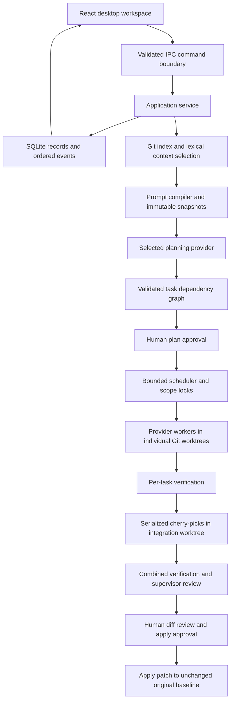

# Architecture

Aether Code separates a sandboxed Electron renderer from a local main-process application service. No browser-only server is needed. See [ADR 001](docs/decisions/001-desktop-and-runtime.md).

## Modules and boundaries

| Module                           | Responsibility                                                                                    |
| -------------------------------- | ------------------------------------------------------------------------------------------------- |
| `shared/types.ts`                | Zod boundary schemas, model/plan/task/event types, public bridge                                  |
| `electron/main.ts`, `preload.ts` | Native window, OS dialogs, encrypted secrets, sender validation, narrow IPC bridge                |
| `electron/core/service.ts`       | Application commands, plan/execution/approval lifecycle, persisted outcomes                       |
| `electron/core/scheduler.ts`     | DAG validation, dependency eligibility, priority, retries, cancellation and file locks            |
| `electron/providers/registry.ts` | Adapter contract, runtime discovery, provider diagnostics, actual CLI/SSE transport               |
| `electron/core/process.ts`       | No-shell subprocess execution, environment allowlist, output caps, process-group cleanup          |
| `electron/core/repository.ts`    | Safe Git calls, selective context, worktrees, commits inside isolated worktrees, tests and diffs  |
| `electron/core/prompts.ts`       | Fixed invariants, precedence, untrusted delimiters, snapshots, budget checks and skill validation |
| `electron/core/store.ts`         | Versioned SQLite schema, JSON records, append-only events, atomic file replacement                |
| `src/App.tsx`, `TaskGraph.tsx`   | Reactive desktop views; real lifecycle state and ordered events                                   |

The service receives a store and provider registry boundary. Contract tests substitute providers; the production registry never contains a test provider. Roles are task metadata rather than mandatory processes. Only approved task plans instantiate workers.

## Execution states

A run proceeds through `initializing → awaiting_approval → running → awaiting_review → completed`. Planning/provider/verification failures become `failed` with a reason. Cancellation becomes `cancelled`. A process interrupted by application exit restores as `blocked`. An approval rejection becomes `cancelled`; isolated evidence remains available.

Tasks begin `queued`, then `running`, optionally `retrying`, then `completed`, `failed`, `blocked`, or `cancelled`. A task completes only after its actual provider returns, file scope validation succeeds, approved verification passes (when specified), and integration succeeds. Completion of a task is not final acceptance of the whole run. `verification: none` is explicitly surfaced; final user review remains required.

Independent scopes run concurrently up to a fixed user-configured cap (1–4). Directory-prefix locks prevent overlapping scopes. Each worker starts from the recorded baseline and receives ancestor commits in topological order. Integration is serialized. Cherry-pick conflicts abort only the agent-owned integration operation and fail the task; no original files are reset. Completed tasks are preserved when failed descendants retry. Workspaces and commit IDs persist so interrupted runs can resume pending work; provider conversation processes themselves are not resumed.

## Instruction precedence

0. Fixed execution invariants
1. Orchestration policy
2. Active, user-authored application fragments
3. Role instructions
4. Provider compatibility
5. Delimited repository instructions/source context
6. User task and output contract
7. Reviewed enabled skills (untrusted data)
8. Verified project memory (untrusted data)

Application policy and task contracts are compiled deterministically. A caller-supplied level-zero fragment cannot replace platform invariants. Duplicate content is removed and inclusion decisions are traced. SHA256 snapshots and conservative byte-based token estimates are recorded; the estimate is not a model tokenizer or guaranteed context window. Imported content is never promoted to runtime permissions. Prompts alone cannot enforce security; runtime controls do.

Project and directory instruction files are selected as repository context, not a fully implemented nested instruction resolver. Conflicting natural-language instructions are not semantically proven consistent; the compiler makes their source and authority inspectable.

## Persistence

Migration 1 creates `records`, ordered `events` (AUTOINCREMENT sequence), and a migration ledger. Records contain validated settings, projects, runs and task state, fragment/skill versions, provider evidence, and memory. Every mutation exports SQLite through `sql.js` and atomically replaces a mode-0600 file. This avoids native SQLite ABI problems in Electron at the cost of full-file exports and a single-writer requirement enforced by the desktop instance lock. Large histories will require native SQLite/WAL and batched writes after measurement. No unmeasured latency/memory guarantees are made.

Events are persisted before dispatch. The renderer replays by sequence in pages, deduplicates sequence IDs, and restores the latest state through a snapshot. It caps displayed events at 2,000; full persisted records remain on disk. CLI output is capped at 4 MB per invocation; individual stored event text is capped at 30,000 characters.

## Honest limitations

The initial scheduler has contention-aware fixed concurrency, not memory/CPU-aware adaptive scheduling or provider-specific rate-limit governors. It records bounded retry failures rather than automatically invoking a separate debugger. There is no symbol database, embedding index, general shell endpoint, marketplace download execution, unattended self-improvement, or automatic deployment. The prompt laboratory performs static inspection; task-completion A/B evaluation remains future work.

Project registration prepares a local Git baseline for folders without history, preserving existing repositories and staged user files. Skills discovery resolves a fixed set of publishers to immutable commits through GitHub's API or a shallow bare Git metadata cache. Preview tokens retain the reviewed revision; installation verifies blobs and stores project scope, provenance and resource hashes as optional fields in existing skill records. This remains backward compatible with the JSON record store. Enabled project packages are verified and copied into isolated worktrees before execution, and remain untrusted prompt inputs.

The mandatory prompt foundation is a pinned compact adaptation of Nexload's reasoning kernel. Aether binds one focused profile to each role and retains execution invariants before that core; fragments, task contracts and untrusted context follow. Planner, worker and supervisor-review snapshots record the actual core revision/profile/hash. Inspection and role previews use the same compiler; no remote prompt service or additional routing model is involved. See docs/development/NEXLOAD_PROMPT_CORE.md for the source and binding contract.
