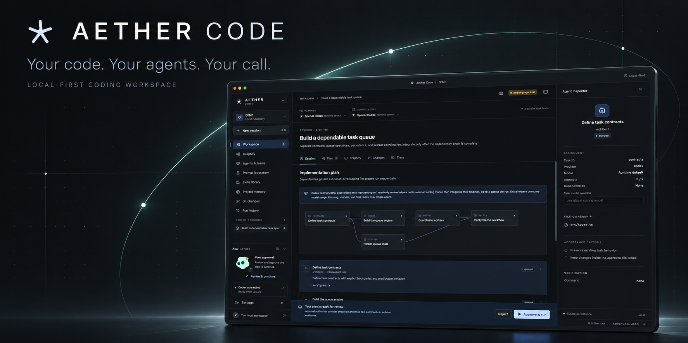
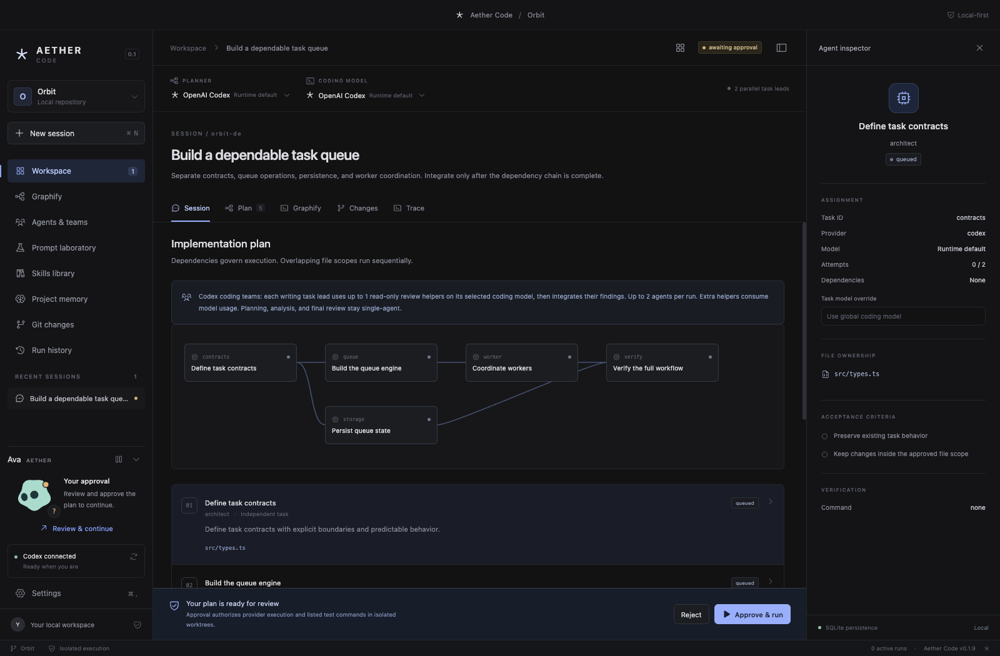
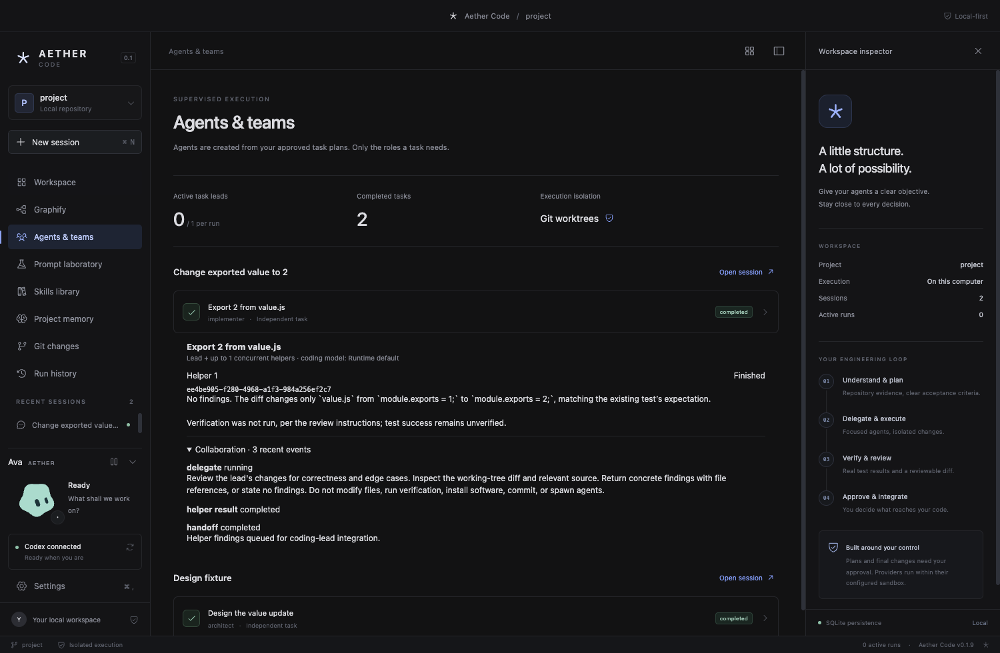
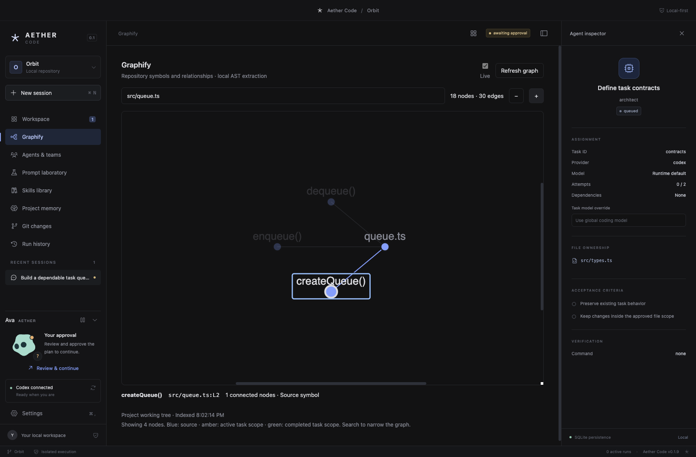
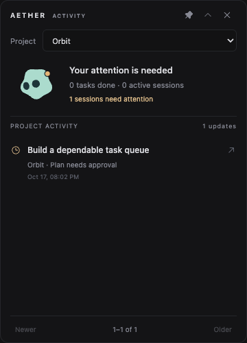
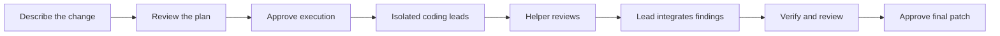

<div align="center">
  
  <h1>Aether Code</h1>
  <p><strong>A local-first workspace for coding agents, with you in control.</strong></p>
  <p>Plan the change. Coordinate the team. Inspect the evidence. Approve what ships.</p>
  <p>
    <a href="package.json"></a>
    <a href="LICENSE"></a>
    <a href="#quick-start"></a>
    <a href="docs/development/CHECKLIST.md"></a>
  </p>
  <p><a href="https://gecut.github.io/aether-agent/">Website</a> · <a href="https://github.com/gecut/aether-agent/releases">Downloads</a> · <a href="#quick-start">Get started</a> · <a href="#a-workspace-you-can-inspect">Explore the workspace</a> · <a href="ARCHITECTURE.md">Architecture</a> · <a href="CONTRIBUTING.md">Contribute</a></p>
</div>

---

Aether turns an objective into a reviewable implementation plan, then runs approved tasks in isolated Git worktrees. Coding leads can work in parallel, ask same-model helpers to review their changes, and integrate the returned findings. Plans, outputs, tests, diffs, prompts, skills, and project memory stay in a local SQLite store.

**You approve the plan before execution and the final patch before it reaches your project.** Local-first describes storage and orchestration; selected cloud providers still receive the task context sent to them.

## A workspace you can inspect



<sub>The real desktop interface, captured with a disposable Orbit demo plan. No personal sessions are shown.</sub>

| Capability                 | What it does                                                                                                                                                 |
| -------------------------- | ------------------------------------------------------------------------------------------------------------------------------------------------------------ |
| **Coding teams**           | A lead implements, 1–3 same-model read-only helpers review, and the lead integrates their findings. Bounded concurrency, cancellation, and visible handoffs. |
| **Scoped execution**       | Task dependencies, file ownership, contention locks, isolated worktrees, retries, and serialized integration.                                                |
| **Live Graphify**          | Inspect actual source symbols and relationships with local AST extraction, search, and task-scope highlighting.                                              |
| **Code-OSS IDE**           | A separate VS Code source-based workspace with Explorer, Git, terminal, Open VSX/VSIX extensions, right-side Ava chat, and Back to Aether.                   |
| **Searchable models**      | Search runtime catalogs and published aliases across Codex, Claude, Antigravity, and compatible APIs; availability remains explicit.                         |
| **Context efficiency**     | Economy/Balanced/Thorough budgets, bounded conversation windows and compact review logs while retaining full local evidence.                                 |
| **Nexload prompt core**    | Pinned, compact reasoning profiles with inspectable source provenance, prompt snapshots, and bounded context.                                                |
| **Project skills**         | Discover skills from OpenAI, Anthropic, and Vercel; inspect a pinned package before installing it into your project.                                         |
| **Ava & desktop activity** | A reactive companion and floating project widget show work, questions, approvals, and completed tasks.                                                       |
| **Reviewable evidence**    | Actual command output, exit codes, diffs, ordered events, and separate plan/apply approvals.                                                                 |
| **Project continuity**     | Local history and memory, analysis-to-implementation follow-ups, automatic initial Git setup, and English/Persian/Arabic text support.                       |

<table>
  <tr>
    <td width="50%">
      <a href="docs/assets/coding-team.png"></a>
      <strong>Follow the handoff.</strong><br />Inspect helper findings and the evidence returned to the coding lead.
    </td>
    <td width="50%">
      <a href="docs/assets/graphify.png"></a>
      <strong>Explore the code.</strong><br />Navigate source relationships without a hosted semantic indexing step.
    </td>
  </tr>
</table>

<details>
<summary><strong>A small presence on your desktop</strong></summary>
<br />


Filter by project, browse completed tasks, pin or collapse the widget, and open the relevant session. Widget actions navigate; they never approve or apply changes.

</details>

<sub>Banner: AI-assisted artwork using an actual app screenshot. Orbit views use demo data; the coding-team view comes from a real isolated Codex test. [Image provenance and regeneration](docs/assets/README.md).</sub>

## Quick start

Downloaded desktop builds include native Codex and its execution helpers; use Settings to sign in on each device. Claude and Antigravity offer **Install & sign in** through official installers.

**From source, tested on macOS arm64:** you need Node.js 24+, npm and Git. Prepare the pinned Codex runtime below, or use a compatible official CLI installation. Rust is not required.

```sh
gh repo clone gecut/aether-agent
cd aether-agent
npm ci
npm run prepare:providers
npm run dev
```

Open **Settings**, run provider diagnostics, and choose your planner and coding model. Leave a model identifier empty to use the runtime default, or enter an account-supported identifier. Use the provider's supported sign-in flow if needed.

Use **Import project** to clone a GitHub repository (`owner/repository`) or another HTTPS Git URL, or open an existing local project created with any tool. Choose a clone location, then optionally review and install Aether’s project workflow and feature verification skills before continuing to the workspace or IDE. **Project actions → Project setup & skills** reopens this step later. Private clones use an existing Git credential helper or signed-in GitHub CLI; Git must be installed. Import does not run dependencies, submodules or project scripts.

The home screen lists your recent projects. Use **Continue in IDE** to reopen the latest one, or choose another project from the sidebar picker. Aether remembers the last project opened across restarts; folder paths distinguish projects with the same name.

Open **IDE → Set up full IDE** to download the checksum-verified Code-OSS runtime. Install compatible extensions from Open VSX or VSIX in its Extensions view; Microsoft-only Marketplace extensions are not guaranteed. The lightweight Quick editor remains available without that download. See [IDE details](docs/development/EDITOR.md) and [measured context savings](docs/development/EFFICIENCY_RESEARCH.md).

Every successful push publishes Windows x64, macOS Apple Silicon/Intel, and Linux x64 development builds to [GitHub Releases](https://github.com/gecut/aether-agent/releases), with SHA256 checksums. See [automatic release details](docs/development/RELEASES.md).

For a production build or a local macOS package:

```sh
npm run build
npm start

# Create an ad-hoc signed .app and ZIP in release/
npm run package
```

The local app is `release/mac-arm64/Aether Code.app`. CI also packages Windows and Linux downloads. macOS previews are ad-hoc signed but not Apple-notarized; Windows builds are unsigned. See [Mac download and approval notes](docs/development/MACOS_RELEASES.md). Automatic app installation is not implemented.

### Your first change

1. Open a local project with the project switcher or **⌘ O**. Aether initializes Git and creates a local initial baseline for eligible new folders; it preserves existing history and staged work.
2. Describe the outcome. Inspect the generated tasks, dependencies, file scopes, model choices, and verification commands.
3. Select **Approve & run**. Workers execute in isolated worktrees; overlapping scopes run sequentially. New plans enable one coding review helper by default; adjust the limit in Settings.
4. Inspect **Changes**, tests, helper findings, and **Trace**. Completed analysis sessions can continue into a separate implementation plan.
5. Select **Apply changes** after review. Aether checks your original repository still matches its clean baseline and applies the patch without publishing or committing it.

Execution needs a clean original working tree. Aether never stashes or resets your changes. Dependency installation is not automatic; see [development and troubleshooting](docs/development/ENVIRONMENT.md).

## Providers

| Provider               | Current capability                                                                                                                                                                                     |
| ---------------------- | ------------------------------------------------------------------------------------------------------------------------------------------------------------------------------------------------------ |
| **OpenAI Codex**       | Verified planning, coding teams, isolated implementation, streaming, cancellation, and read-only final review through the official CLI. Uses an existing supported CLI login.                          |
| **Claude Code**        | Read-only planning/review adapter. Actual integration remains unverified; coding is disabled pending a verified sandbox.                                                                               |
| **Google Antigravity** | Text-only chat/planning/review with a tool-free temporary profile, official OAuth setup and model discovery. Coding remains disabled; the tested account/location was blocked by provider eligibility. |
| **Compatible API**     | `/models` and `/chat/completions` SSE for planning/review. No filesystem coding tools.                                                                                                                 |

Provider installation, authentication, and actual inference are separate states. See [setup and capability evidence](docs/providers/README.md) and [Hermes connector research](docs/providers/HERMES_CONNECTORS.md).

## How execution fits together



Coding teams use separate managed Codex sessions on the task's chosen coding configuration. Helpers review in read-only mode; the lead writes and integrates. Findings are bounded, redacted, and treated as untrusted evidence. [Coding-team details](docs/development/CODING_TEAMS.md).

## Development & verification

```sh
npm test                  # deterministic tests; no external model calls
npm run test:e2e          # build + real Electron UI/persistence checks
npm run format:check
npm run test:widget       # floating widget and native lifecycle
npm run test:live-ui      # live graph, text direction, and Ava
npm run test:provider     # actual Codex workflow in a disposable repository
node scripts/package-smoke.mjs  # run after packaging
```

The v0.1.9 implementation passed 84 automated tests, desktop acceptance, actual Codex team execution, and packaged launch/persistence checks. The real-provider smoke uses your current account and consumes model usage; it automatically approves only its narrowly defined disposable fixture. [Verification evidence](docs/development/VERIFICATION.md).

`npm run analyze:graph` uses an installed Graphify CLI for code-only AST extraction. `npm run benchmark` records a disposable context/streaming benchmark and CPU profile. Scoped source excerpts, related imports, bounded handoffs, and batched stream persistence keep context and UI work bounded. Token estimates are not billing measurements. [Performance notes](docs/development/PERFORMANCE.md).

## Data & boundaries

On macOS, application data lives in `~/Library/Application Support/aether-code/`. CLI credentials stay in the provider's credential store; Aether does not copy OAuth tokens. An optional compatible API key uses Electron `safeStorage` and is not returned to the renderer. No `.env` file is required for CLI use.

The Electron renderer has no Node access and uses validated IPC. Provider subprocesses have bounded output, timeouts, cancellation, a restricted environment, and their configured sandbox. **Approved verification commands execute repository code on your host outside the Codex sandbox.** Worktrees isolate changes, and scope checks detect violations after execution; they are not an operating-system sandbox.

Use trusted projects and inspect approved commands. The metadata database is unencrypted, and retained worktrees contain source and execution evidence. See [security boundaries and remaining gaps](SECURITY.md).

## Project guide

- [Architecture and module boundaries](ARCHITECTURE.md)
- [Automatic builds and releases](docs/development/RELEASES.md)
- [Contributing](CONTRIBUTING.md) · [Implementation checklist](docs/development/CHECKLIST.md)
- [Nexload prompt core](docs/development/NEXLOAD_PROMPT_CORE.md)
- [Coding teams](docs/development/CODING_TEAMS.md) · [Live graph](docs/development/LIVE_GRAPH.md)
- [Ava companion](docs/development/COMPANION.md) · [Desktop widget](docs/development/DESKTOP_WIDGET.md)
- [Provider setup](docs/providers/README.md) · [Development environment](docs/development/ENVIRONMENT.md)

This is a developer preview. Remaining work includes hardened verification isolation, additional verified coding providers, dependency provisioning, stronger budget enforcement, worktree retention controls, and signed distribution with broader cross-platform runtime validation.

## License & acknowledgements

[MIT](LICENSE). Third-party fonts and vendored components retain their own licenses; see [notices](THIRD_PARTY_NOTICES.md). Aether's compact prompt foundation adapts the pinned [Nexload reasoning system](https://github.com/gecut/nexload-sdk), Ava uses an adapted [Bloub animation core](https://github.com/jeremy-prt/bloub), and live source exploration uses [Graphify](https://github.com/Graphify-Labs/graphify).
